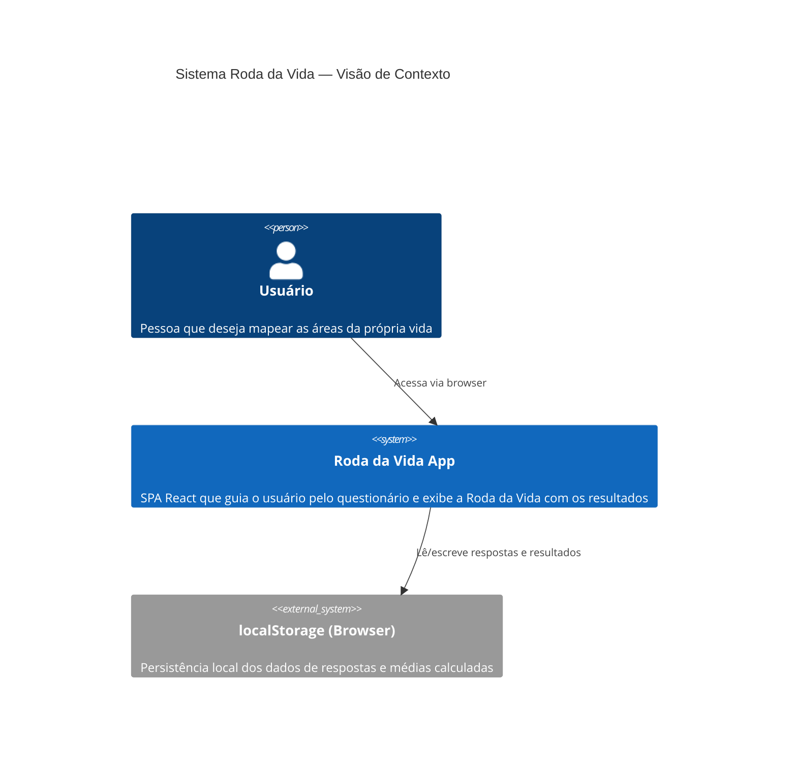
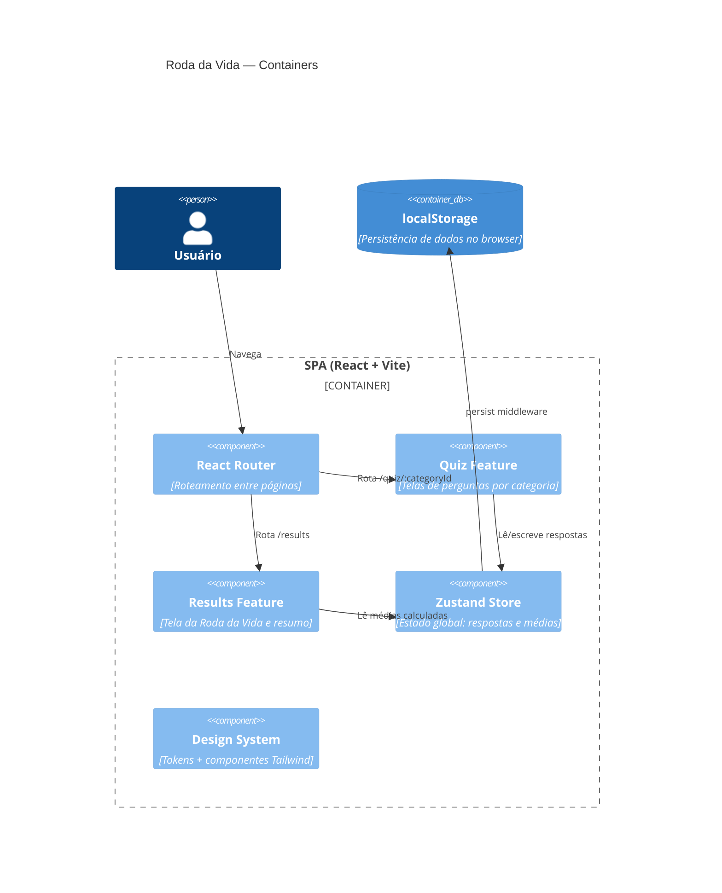
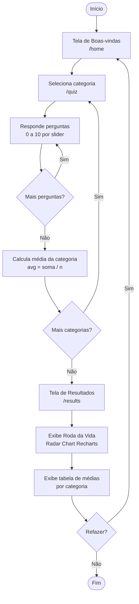
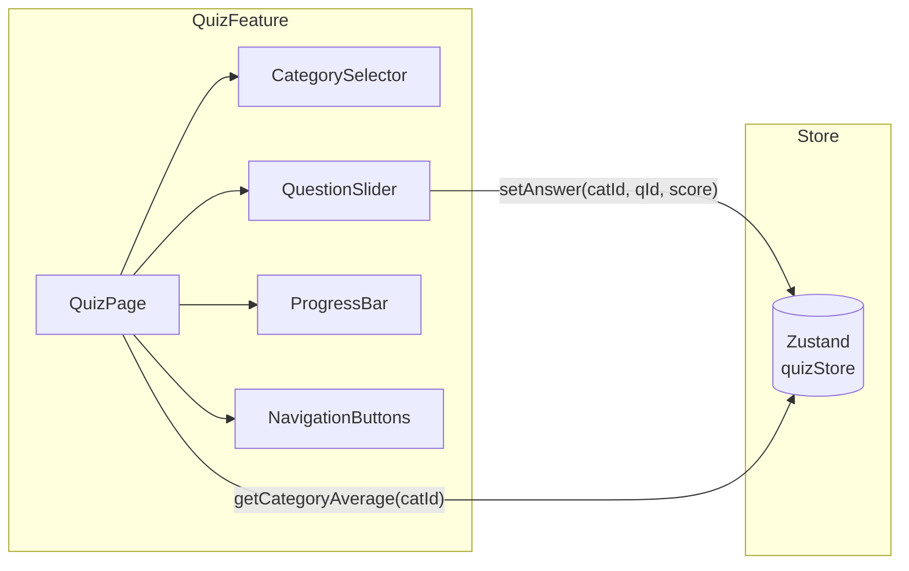
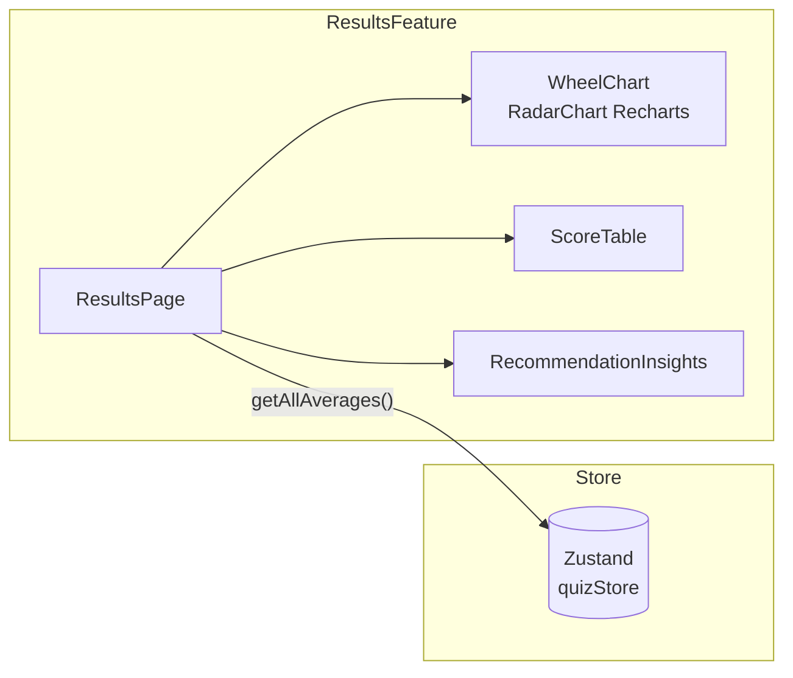

# Diagrama Geral — Arquitetura do Sistema

## Visão Macro (C4 — Nível 1: Context)

---

## Visão de Containers (C4 — Nível 2)

---

## Fluxo do Usuário

---

## Categorias da Roda da Vida (MVP)

| # | Categoria               | Ícone sugerido | Descrição                                           |
|---|-------------------------|----------------|-----------------------------------------------------|
| 1 | Saúde e Corpo           | 💪             | Exercícios, alimentação, sono, energia física        |
| 2 | Mente e Emoções         | 🧠             | Saúde mental, equilíbrio emocional, autoconhecimento|
| 3 | Relacionamentos         | ❤️             | Família, amizades, amor, rede de apoio              |
| 4 | Carreira e Propósito    | 🚀             | Trabalho, missão, impacto profissional               |
| 5 | Capacitação e Estudos   | 📚             | Aprendizado contínuo, habilidades, cursos            |
| 6 | Finanças                | 💰             | Renda, investimentos, segurança financeira           |
| 7 | Lazer e Diversão        | 🎮             | Hobbies, descanso, prazer, criatividade              |
| 8 | Espiritualidade         | ✨             | Fé, propósito de vida, conexão com algo maior        |

---

## Diagrama de Componentes (Nível 3 — Feature Quiz)

