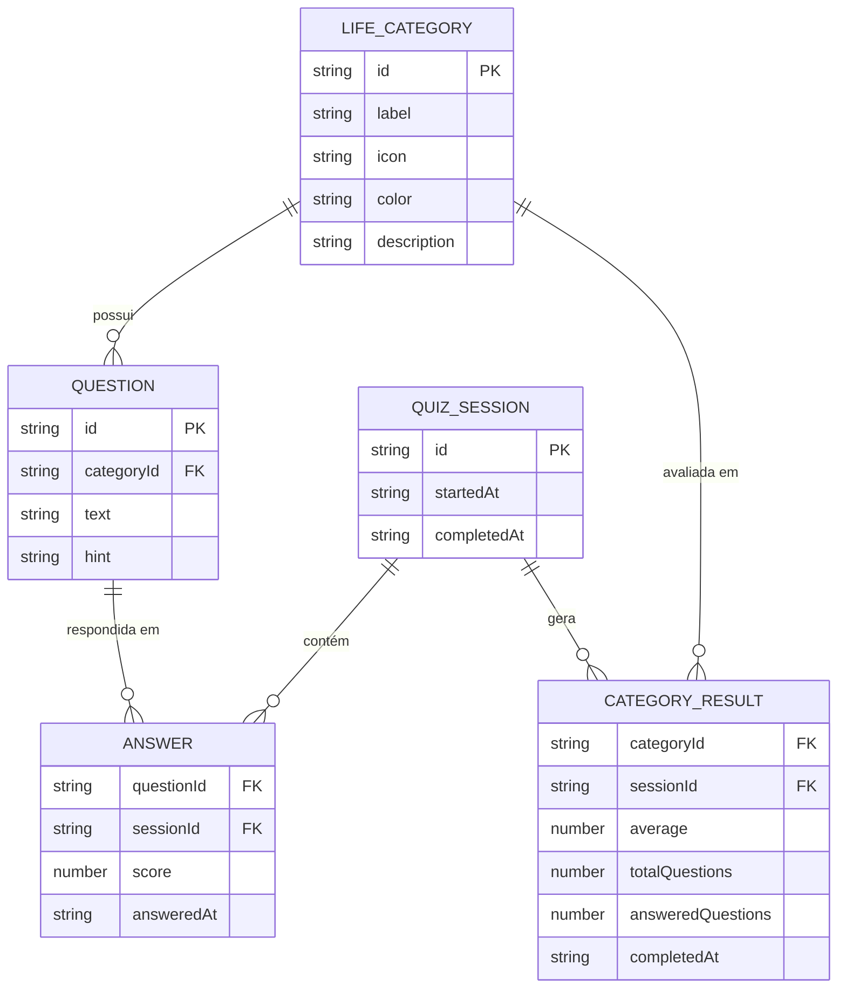
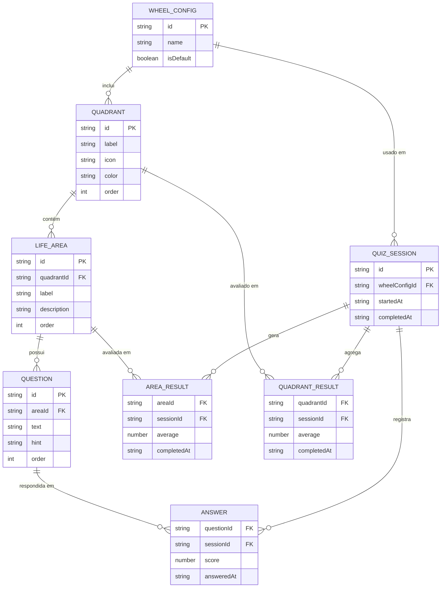

# Modelagem de Dados

> O MVP não possui banco de dados relacional. Todos os dados são armazenados no **`localStorage`** do browser via Zustand `persist` middleware. Este documento descreve o modelo de dados lógico e as estruturas TypeScript correspondentes.

> [!IMPORTANT]
> O modelo do MVP usa uma hierarquia **flat** (categoria → perguntas). O backend futuro introduzirá uma hierarquia de três níveis: **Quadrante → Área → Perguntas**. Consulte o [ADR 0005](../adr/0005-hierarquia-quadrantes-areas-perguntas.md) para detalhes completos da decisão.

---

## Entidades Principais

### 1. `LifeCategory` — Categoria da Roda da Vida

Representa uma área da vida avaliada (ex.: Saúde, Carreira).

```ts
interface LifeCategory {
  id: string;              // ex.: "health", "career"
  label: string;           // ex.: "Saúde e Corpo"
  icon: string;            // emoji ou nome do ícone
  color: string;           // cor hex para o gráfico
  description: string;     // descrição breve exibida ao usuário
  questions: Question[];   // lista de perguntas desta categoria
}
```

### 2. `Question` — Pergunta do Questionário

Cada pergunta tem escala de resposta de 0 a 10.

```ts
interface Question {
  id: string;       // ex.: "health-q1"
  text: string;     // texto da pergunta
  hint?: string;    // dica ou contexto opcional
}
```

### 3. `Answer` — Resposta do Usuário

Uma resposta pontual a uma pergunta específica.

```ts
interface Answer {
  questionId: string;   // referência à Question
  score: number;        // 0 a 10 (inteiro)
  answeredAt: string;   // ISO 8601 timestamp
}
```

### 4. `CategoryResult` — Resultado Calculado por Categoria

Gerado após o usuário responder todas as perguntas de uma categoria.

```ts
interface CategoryResult {
  categoryId: string;
  totalQuestions: number;
  answeredQuestions: number;
  average: number;       // soma(scores) / answeredQuestions, arredondado 1 casa
  completedAt: string;   // ISO 8601 timestamp
}
```

### 5. `QuizSession` — Sessão Completa do Questionário

Representa uma execução completa (ou parcial) do questionário.

```ts
interface QuizSession {
  id: string;                            // UUID v4
  startedAt: string;                     // ISO 8601
  completedAt?: string;                  // Preenchido ao finalizar todas as categorias
  answers: Record<string, Record<string, Answer>>;
  // { categoryId: { questionId: Answer } }
  results: Record<string, CategoryResult>;
  // { categoryId: CategoryResult }
}
```

---

## Diagrama de Relacionamento (Lógico)



---

## Estrutura no `localStorage`

```json
{
  "roda-da-vida-quiz-store": {
    "state": {
      "currentSession": {
        "id": "uuid-v4",
        "startedAt": "2026-10-14T22:00:00.000Z",
        "answers": {
          "health": {
            "health-q1": { "questionId": "health-q1", "score": 8, "answeredAt": "..." },
            "health-q2": { "questionId": "health-q2", "score": 6, "answeredAt": "..." }
          },
          "career": {
            "career-q1": { "questionId": "career-q1", "score": 9, "answeredAt": "..." }
          }
        },
        "results": {
          "health": {
            "categoryId": "health",
            "totalQuestions": 3,
            "answeredQuestions": 2,
            "average": 7.0,
            "completedAt": "..."
          }
        }
      }
    },
    "version": 1
  }
}
```

---

## Cálculo da Média

```
average(category) = Σ(scores de todas as perguntas respondidas) / n_perguntas_respondidas
```

- Arredondamento: 1 casa decimal (ex.: `7.3`)
- Categoria não iniciada: `average = 0`
- Exibição no gráfico: escala de `0` a `10`

---

---

## Modelo Futuro — Backend com Hierarquia Quadrante → Área → Pergunta

> Planejado para implementação pós-MVP. Consulte o [ADR 0005](../adr/0005-hierarquia-quadrantes-areas-perguntas.md).

Quando o backend for implementado, o modelo flat de `LifeCategory` será expandido para três entidades distintas:

### `Quadrant` — Quadrante da Roda

Agrupamento macro. É o eixo exibido no gráfico principal.

```ts
interface Quadrant {
  id: string;          // ex.: "quality-of-life"
  label: string;       // ex.: "Qualidade de Vida"
  icon: string;        // emoji ou nome do ícone
  color: string;       // cor hex usada no gráfico
  order: number;       // ordem de exibição na roda
  areas: LifeArea[];   // áreas que compõem este quadrante
}
```

### `LifeArea` — Área de Vida

Subdivisão de um quadrante. Aparece no detalhamento por quadrante.

```ts
interface LifeArea {
  id: string;           // ex.: "creativity"
  quadrantId: string;   // FK → Quadrant
  label: string;        // ex.: "Criatividade"
  description: string;  // descrição exibida ao usuário
  order: number;        // ordem dentro do quadrante
  questions: Question[];
}
```

### `WheelConfig` — Configuração de uma Roda personalizada

Permite criar rodas temáticas com diferentes conjuntos de quadrantes.

```ts
interface WheelConfig {
  id: string;
  name: string;           // ex.: "Roda da Vida Completa"
  description: string;
  quadrantIds: string[];  // quais quadrantes fazem parte desta roda
  isDefault: boolean;     // se é a roda exibida por padrão
  createdAt: string;
}
```

### Mapeamento MVP → Futuro Backend

| MVP (atual)          | Backend futuro         | Observação                              |
|----------------------|------------------------|-----------------------------------------|
| `LifeCategory`       | `Quadrant`             | Categoria vira quadrante                |
| *(não existe)*       | `LifeArea`             | Novo nível intermediário                |
| `Question`           | `Question`             | Mantido, agora vinculado a `LifeArea`   |
| Hardcoded no frontend| Configurável via API   | Estrutura vem do backend                |

### Exemplo: Quadrante Qualidade de Vida

```
Quadrante: Qualidade de Vida
├── Área: Criatividade
│     ├── "Com que frequência você expressa sua criatividade?"
│     └── "Você tem espaço para criar no dia a dia?"
├── Área: Hobbies e Diversão
│     ├── "Você dedica tempo regular aos seus hobbies?"
│     └── "Seu lazer te recarrega de energia?"
├── Área: Plenitude e Felicidade
│     ├── "Com qual frequência você sente gratidão?"
│     └── "Você se sente realizado com o caminho que trilha?"
└── Área: Espiritualidade
      ├── "Você tem uma prática espiritual regular?"
      └── "Você sente conexão com algo maior?"
```

### Diagrama ER Futuro (Backend)



---

## Versionamento do Schema

O campo `version` no `localStorage` permite migrações futuras:

| Versão | Mudanças                                      |
|--------|-----------------------------------------------|
| 1      | Schema inicial do MVP                         |
| (futuro) 2 | Adição de histórico de sessões passadas |
| (futuro) 3 | Sincronização com backend via API        |
